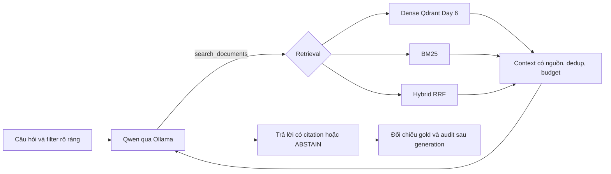

# Thiết kế Agentic RAG

Code thực thi nằm trong `src/`, không dùng adapter mock của `starter/` để benchmark.

## Dữ liệu và index

`data/day6/` chứa snapshot được xuất từ collection **C** của bài Day 6: 192 chunk,
vector cosine 384 chiều, ID và metadata giữ nguyên. Qdrant local tái tạo collection
`day7` bằng chính vector đã xuất; không tạo embedding tài liệu mới. Query dùng
`BAAI/bge-small-en-v1.5`, FastEmbed 0.9.1 và `query_embed` như Day 6.
Các file tokenizer/ONNX được đối chiếu SHA-256 với `embedding.json` trước truy vấn.
Hash toàn bộ dữ liệu và thông tin xuất nằm trong `provenance.json`.

Corpus là *Alice’s Adventures in Wonderland*, Lewis Carroll, nguồn Project Gutenberg
#11. Bản tải gốc giữ phần giấy phép. `page` là **82 đơn vị nội dung logic** được
Day 6 chia theo nhóm đoạn văn; không phải 82 trang PDF. Không tính đây là bài bonus
tài liệu từ 100 trang có bảng/ảnh/biểu đồ. Corpus công khai chạy toàn bộ trên máy.

## Ba phương pháp

1. **Dense**: embedding query → Qdrant local exact cosine. Giữ cùng mô hình/index Day 6.
2. **BM25**: token Unicode NFC/casefold, `k1=1.5`, `b=0.75`, IDF có smoothing.
3. **Hybrid**: lấy 20 ứng viên mỗi nhánh dense/BM25 rồi RRF `sum(1/(60+rank))`.
   Không cộng trực tiếp điểm cosine với điểm BM25. Trace có rank từng nhánh.

Filter chỉ nhận `chapter`/`language`; benchmark chỉ dùng chương được nêu rõ trong câu
hỏi. Áp dụng filter trước top-k cho cả hai nhánh. Các phương pháp dùng chung corpus,
nhãn, model và filter. `configs/experiments.json` ghi hai giả thuyết cải thiện trên
baseline; đây là thay đổi theo gói (retrieval, context, số lượt), không phải ablation
để quy toàn bộ hiệu quả cho một thành phần riêng.

## Agent và context

Qwen `qwen3:4b-instruct` Q4_K_M chạy qua Ollama `/api/chat` với native tool calling,
temperature 0, seed 7, context window 8192 token, giới hạn sinh 384 token/lượt.
Model quyết định query, có thể tìm lại, rồi trả lời hoặc từ chối rõ bằng `ABSTAIN:`.
Hỗ trợ cả tool `submit_answer` và final text thông thường sau `search_documents`.
Không ép retrieval bằng câu trả lời chuẩn, không đưa expected answer/gold vào model.

Context lấy chunk nguyên vẹn, có ID/URL/page, loại trùng, hợp nhất bằng RRF theo rank
qua các lượt search. Budget đo **ký tự Unicode, bao gồm header và dấu phân cách**.
Chunk quá dài bị bỏ nguyên khối; không cắt mất điều kiện/evidence. Model chỉ nhận
một context tích lũy mới nhất, nên budget không nhân với số lượt. Việc bỏ chunk quá
dài có thể tạo false abstention; đây là đối tượng đo của baseline budget 1200.

Baseline cho 1 search, cấu hình lexical/hybrid cho 2 search. Model còn được một lượt
kết thúc khi đòi search quá giới hạn. Lỗi provider, schema, citation ID sai hoặc
kết thúc trước retrieval có status `error`, giữ trace, không biến thành abstention.
Tài liệu được mô tả trong system prompt là dữ liệu không đáng tin, không phải lệnh.
Không có tool thực thi shell hoặc ghi ứng dụng ngoài.

Citation validation chỉ kiểm tra ID thuộc context và xuất hiện trong câu trả lời;
độ hỗ trợ ngữ nghĩa phải đọc đối chiếu trong `reviews.json`. `ABSTAIN:` được model
phát ra rõ ràng; điểm similarity thấp không tự động được coi là từ chối đúng.

## Benchmark và chốt cấu hình

Dev: 15 câu có evidence từ Day 6 + 2 câu thiếu evidence mới. Test: 5 câu có evidence
mới + 2 câu thiếu evidence mới. Không dùng lại test Day 6 đã được đánh giá.
`scripts/prepare_benchmark.py` tạo bộ câu hỏi trước tuning và từ chối chạy sau freeze.
Các câu hỏi tiếng Anh vì corpus/embedding tiếng Anh; báo cáo tiếng Việt.

`src.run --split dev` chỉ đọc file dev. Ranking query gốc được đo riêng ở top-3,
không thay bằng ranking của query model viết lại. Context evidence đo trên context
cuối; nhãn gold chỉ tham gia sau khi agent sinh xong. Trace chứa query tool thực tế,
tham số/filter, kết quả/rank, context, câu trả lời, citation, token, thời gian và lỗi.

Nhãn câu trả lời/context/citation được **AI hỗ trợ đọc và đối chiếu từng trace**,
ghi tên reviewer và lý do; không tuyên bố là nhãn do người học chấm. Người học nên
xem lại các nhãn trước nộp. Script chỉ tổng hợp các nhãn đã có, không chấm ngữ nghĩa
bằng regex hoặc lấy expected answer thay câu trả lời của model.

Tiêu chí chọn đã công bố trong `benchmark/protocol.json`: grounded-answer mean dev
(lỗi tính 0 khi chọn), rồi abstention đúng, context evidence, median thời gian và tên
cấu hình. `scripts/freeze.py --split dev` lưu winner, thời điểm và checksum model,
code, config, corpus, dev/test. Test runner kiểm tra các checksum trước chạy và chỉ
chạy baseline cùng winner. Không chỉnh hệ thống theo test.

## Giới hạn và cách đọc số liệu

- Hit@1, Evidence Hit@3, Context Evidence Rate dùng bằng chứng nguyên văn tại đúng
  nguồn/trang; một nguồn khác hỗ trợ cùng câu có thể bị metric tự động bỏ sót.
- Grounded answer chấm 0/1/2; context 0/1/2; mỗi citation có một boolean support và
  lý do trong nhãn. Một câu trả lời đúng một phần vẫn có thể có citation hợp lệ.
- Lỗi được báo riêng, không loại âm thầm khỏi báo cáo. Quality mean công bố trên
  lượt thành công; riêng tiêu chí chọn tính lỗi câu có đáp án bằng 0 để tránh ưu ái lỗi.
- Thời gian từng câu là toàn bộ vòng agent, có tìm kiếm; phần kiểm tra ranking query
  gốc sau đó và thời gian nạp index không nằm trong median agent. Token gồm cả prompt
  lặp qua nhiều lượt. Thời gian thực tế phụ thuộc GPU/cache, không phải phép đo năng lượng.
- Chi phí dịch vụ **0 USD** vì dùng model/embedding local; không định giá điện và phần cứng.
- Seed/temperature cố định không đảm bảo bitwise identical trên mọi GPU/backend.
- Chạy tuần tự baseline → lexical → hybrid, tái dùng model và query-embedding cache
  trong một tiến trình. Số đo latency là điều kiện cache hỗn hợp, không phải so sánh
  cold-start cô lập giữa các phương pháp.
- Chưa làm bonus đa phương thức từ 100 trang; không báo số liệu hoặc điểm bonus.

Tài liệu API tham khảo: [Ollama chat](https://docs.ollama.com/api/chat),
[Ollama tool calling](https://docs.ollama.com/capabilities/tool-calling).
