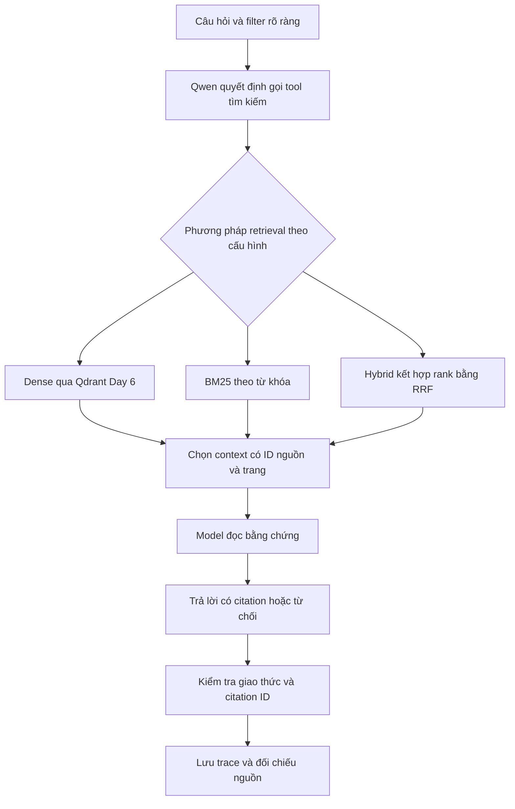

# Báo cáo demo Agentic RAG Day 7

**Phan Trọng Hậu · MSSV 2A202603547 · Lớp L3A**

## 1. Kết quả chính

Bài làm xây agent hỏi đáp trên tài liệu, dùng lại dữ liệu và vector store Day 6. Tôi so sánh dense retrieval, BM25 và hybrid RRF trên dev, rồi chọn **BM25 kết hợp context 4.800 ký tự** theo tiêu chí công bố trước khi đánh giá test.

Theo nhãn đối chiếu có AI hỗ trợ, cấu hình chọn trả lời đầy đủ, có citation hỗ trợ cho **5/5 câu test có đáp án**. Hai câu test thiếu bằng chứng gặp lỗi điều phối: model từ chối trước khi gọi retrieval. Vì vậy, kết quả này **không có nghĩa toàn bộ 7 câu test đều đạt**, và chưa chứng minh hệ thống từ chối đúng trên holdout. Báo cáo giữ nguyên các lỗi thay vì tính chúng thành thành công.

Thông điệp của phần demo là cần đo riêng việc tìm tài liệu, chọn context, trả lời và dẫn nguồn. Một tầng tốt không bảo đảm các tầng sau đều đúng.

## 2. Mục tiêu và dữ liệu

Agent cần tìm bằng chứng trong corpus, trả lời kèm nguồn và nhận biết khi không có đủ thông tin. Đầu vào là câu hỏi và filter người dùng nêu rõ; đầu ra gồm câu trả lời hoặc trạng thái từ chối, citation và trace để kiểm tra.

| Thành phần | Thiết lập thực tế |
|---|---|
| Corpus | Alice’s Adventures in Wonderland, Lewis Carroll, Project Gutenberg #11 |
| Dữ liệu tiếp nối | Collection C của Day 6, giữ nguyên chunk ID, text, source, page và metadata |
| Quy mô | 192 chunk, 82 đơn vị trang logic; không phải 82 trang PDF |
| Embedding | BAAI/bge-small-en-v1.5, 384 chiều, FastEmbed 0.9.1 |
| Vector store | Qdrant local, cosine; tái tạo từ vector thật đã xuất ở Day 6 |
| Model điều phối | qwen3:4b-instruct, Q4_K_M, Ollama local |
| Thiết lập model | Temperature 0, seed 7, context window 8.192 token |
| Thiết bị đo | NVIDIA GTX 1650 4 GB, CPython 3.14.9 |

Văn bản gốc và giấy phép Gutenberg được giữ trong `data/day6/alice.txt`. Model và dữ liệu có checksum để phát hiện thay đổi. Query embedding dùng cùng model và cách gọi với Day 6; không dùng vector ngẫu nhiên để đánh giá.

Benchmark có **24 câu**: dev gồm 15 câu có đáp án và 2 câu thiếu bằng chứng; test gồm 5 câu có đáp án mới và 2 câu thiếu bằng chứng mới. Không dùng lại test Day 6 đã từng được đánh giá. Câu hỏi dùng tiếng Anh phù hợp với corpus và embedding.

## 3. Hệ thống hoạt động như thế nào



Model gọi tool `search_documents` với query do nó tạo. Tool dùng phương pháp đã cấu hình, không cho model tiếp cận đáp án chuẩn. Hệ thống giữ chunk nguyên vẹn, loại trùng và chọn context trong giới hạn ký tự, bao gồm cả header nguồn. Mỗi lần tìm, model chỉ nhận context tích lũy mới nhất để tránh nhân budget theo số lượt.

Model có thể kết thúc bằng `submit_answer` hoặc final text có citation dạng `[chunk-id]`. Khi thiếu bằng chứng, model cần từ chối rõ bằng `ABSTAIN:`. Lỗi kết nối, định dạng hay citation không hợp lệ được giữ là `error`. Việc từ chối trước khi tìm kiếm cũng không được công nhận là hoàn thành yêu cầu search-and-abstain.

Citation được kiểm tra theo hai bước: ID có nằm trong context hay không, và nội dung nguồn có thật sự hỗ trợ câu trả lời hay không. Bước thứ hai cần đọc đối chiếu; kiểm tra ID bằng code chưa đủ.

## 4. Ba phương pháp và hai cấu hình cải thiện

| Cấu hình | Cách tìm | Top-k | Context ký tự | Search tối đa |
|---|---|---:|---:|---:|
| Baseline | Dense cosine qua Qdrant Day 6 | 3 | 1.200 | 1 |
| Lexical | BM25, k1 = 1,5 và b = 0,75 | 5 | 4.800 | 2 |
| Hybrid | RRF, hằng số 60, lấy 20 ứng viên mỗi nhánh | 5 | 4.800 | 2 |

**Giả thuyết cải thiện 1:** BM25 có thể giữ tốt các từ khóa cụ thể như cake, currants, tên nhân vật; context lớn hơn có thể chứa thêm điều kiện cần cho đáp án.

**Giả thuyết cải thiện 2:** hybrid kết hợp ranking ngữ nghĩa và từ khóa có thể khôi phục evidence bị một nhánh bỏ sót. RRF hợp nhất theo thứ hạng, không cộng trực tiếp điểm cosine với điểm BM25 khác thang đo.

Đây là so sánh theo gói cấu hình, có thay cả retriever và context budget. Chưa thể tách riêng đóng góp của từng thay đổi. Trong các trace thực tế, mọi câu đã gọi tool đều chỉ tìm **một lần**, nên chưa có bằng chứng về lợi ích của multi-round dù cấu hình cho phép hai lần.

## 5. Đánh giá trên dev và quyết định chọn

Hit@1 và Evidence Hit@3 đo ranking của **query gốc**. Context Evidence Rate đo đủ evidence trong context cuối thật sự gửi model. Grounded answer được chấm 0–2: sai hoặc thiếu hỗ trợ, đúng một phần, đúng đầy đủ và được citation hỗ trợ.

| Cấu hình dev | Hit@1 | Evidence Hit@3 | Context đủ evidence | Điểm chọn /2 | Median giây/câu | Lỗi |
|---|---:|---:|---:|---:|---:|---:|
| Baseline | 9/15 | 14/15 | 9/15 | 1,067 | 8,87 | 0 |
| Lexical | 13/15 | 14/15 | 14/15 | **1,400** | 19,99 | 0 |
| Hybrid | 12/15 | 15/15 | 15/15 | 1,333 | 17,78 | 1 |

Điểm dùng để chọn tính lỗi trên câu có đáp án bằng 0. Nếu hòa, lần lượt xét abstention đúng, context evidence, median thời gian và tên cấu hình. Tiêu chí nằm trong `benchmark/protocol.json`; quyết định và checksum được lưu ở `results/selection.json` trước khi chạy test.

**Chọn lexical** vì có điểm dev cao nhất theo tiêu chí này. Hybrid tìm đủ evidence cho 15/15 câu nhưng chưa chuyển được lợi thế retrieval thành chất lượng trả lời cao nhất: vẫn có lỗi hiểu nội dung, citation sai nguồn và một lỗi định dạng citation.

Đánh đổi là thời gian: median lexical khoảng 20 giây/câu, so với 8,87 giây của baseline. Chi phí dịch vụ là 0 USD vì chạy local; chưa tính điện và phần cứng. Thứ tự chạy và cache dùng chung ảnh hưởng latency, nên đây không phải phép so sánh cold-start cô lập.

## 6. Kết quả test sau khi chốt cấu hình

| Chỉ số test | Baseline | Lexical được chọn |
|---|---:|---:|
| Hit@1 trên câu có đáp án | 4/5 | 2/5 |
| Evidence Hit@3 | 5/5 | 5/5 |
| Context đủ evidence | 3/5 | 5/5 |
| Grounded grade 2 | 3/5 | **5/5** |
| Grounded mean trên câu có đáp án | 1,20/2 | 2,00/2 |
| Citation hỗ trợ | 3/4 | 6/6 |
| Median giây/câu | 8,52 | 21,12 |
| Lỗi ở câu thiếu bằng chứng | 2/2 | 2/2 |

Lexical có Hit@1 thấp hơn baseline trên bộ test nhỏ, nhưng top-3 và context vẫn đủ evidence cho cả 5 câu. Điều này cho thấy không nên chọn cấu hình chỉ từ top-1 khi hệ thống thực sự dùng nhiều đoạn context.

Ở hai câu thiếu evidence, model phát `ABSTAIN` ngay lượt đầu và không gọi retrieval. Runner đánh dấu lỗi giao thức. Abstention quality trên lượt thành công vì thế là **0/0, không áp dụng**, không phải 100%. Nếu xét toàn bộ quy trình test, lexical có 5 câu đạt đầy đủ và 2 câu lỗi; không được giới thiệu là đạt 7/7.

## 7. Các tình huống trình diễn

### Tình huống 1 cải thiện ở câu hỏi về chiếc bánh

**Câu hỏi dev q04:** “How were the words on the small cake written?”

Baseline từ chối vì query do model viết lại làm dense retrieval chuyển sang đoạn khác. Lexical trả lời chữ được đánh dấu bằng **currants**, có citation ở trang logic 6. Đây là ví dụ cải thiện đo được; phải phân biệt ranking query gốc với query thật của tool.

### Tình huống 2 từ chối có tìm kiếm

**Câu hỏi dev d-missing-1:** “On what exact date was Alice born?”

Trace lexical có retrieval rồi từ chối vì không có ngày sinh chính xác. Corpus đã được rà bằng tìm kiếm chủ đề trên toàn bộ 82 đơn vị, kèm đọc cảnh liên quan; không kết luận thiếu thông tin chỉ từ top-k. Ví dụ này thuộc **dev**, không dùng thay kết quả test.

### Tình huống 3 context đủ nhưng model vẫn sai

**Câu hỏi dev q06:** “What prize did the Dodo present to Alice?”

Đáp án trong nguồn là **a thimble** ở trang logic 16. Context lexical đã có đoạn này, nhưng model vẫn phủ định Dodo tặng quà và cite đoạn Alice phát comfits ở trang 15. Answer grade là 0. Ví dụ giúp giải thích vì sao context đủ và citation ID hợp lệ chưa chứng minh đáp án đúng.

### Tình huống 4 giới hạn trên holdout

**Câu hỏi test t-missing-1:** “How many pounds did the gardeners pay for the red paint used on the roses?”

Raw model output từ chối nhưng chưa tìm kiếm. Không tính đây là abstention đúng. Code/config được giữ nguyên sau freeze; cải thiện tiếp theo cần một vòng dev và bộ test mới nếu đã dùng lỗi holdout để điều chỉnh.

## 8. Lệnh demo và tài liệu đối chiếu

Chạy từ thư mục gốc repo. Phương án ổn định khi trình bày là phát lại trace thật đã lưu; lệnh này không cần Ollama hoặc thư viện ngoài và không tạo benchmark mới:

```bash
python3 scripts/demo.py --scenario improvement
python3 scripts/demo.py --scenario abstention
python3 scripts/demo.py --scenario failure
python3 scripts/demo.py --scenario holdout-error
```

Muốn hỏi trực tiếp model, dùng môi trường và Ollama đã chuẩn bị. Kết quả mới có thể khác lần đã ghi, nên lưu riêng và không cộng vào bảng benchmark đã chốt:

```bash
.venv/bin/python scripts/ask.py "What did the White Rabbit take out of its waistcoat-pocket?" --config lexical --output results/demo/live-watch.json
.venv/bin/python scripts/ask.py "On what exact date was Alice born?" --config lexical --output results/demo/live-abstention.json
```

Lệnh thứ hai có thể phát sinh lỗi giao thức; khi đó trình bày đúng lỗi rồi mở trace đã lưu, không thay bằng một câu trả lời dựng sẵn. Không chạy hai tiến trình hỏi agent đồng thời vì Qdrant local có khóa.

Các điểm cần mở khi được hỏi sâu:

- [Báo cáo kỹ thuật đầy đủ](individual/2A202603547_PhanTrongHau.md).
- [Kịch bản thuyết trình và câu hỏi phản biện](KICH_BAN_THUYET_TRINH.md).
- [Cấu hình thử nghiệm](../configs/experiments.json) và [freeze trên dev](../results/selection.json).
- [So sánh dev](../results/dev/comparison.json), [so sánh test](../results/test/comparison.json).
- [Kiểm tra thiếu evidence trên corpus](../benchmark/absence_audit.json).
- [Trace test lexical](../results/test/lexical/traces.json) và [nhãn đối chiếu](../results/test/lexical/reviews.json).

## 9. Kết luận và phạm vi kết quả

BM25 với context lớn hơn là cấu hình được chọn trên dev và trả lời có căn cứ cho 5 câu test có đáp án. Các lỗi còn lại tập trung ở việc model hiểu evidence, chọn citation và tuân thủ yêu cầu tìm trước khi từ chối. Hệ thống đã có trace để chỉ ra lỗi ở tầng nào.

Benchmark nhỏ, nhãn có AI hỗ trợ và cần người học xác nhận; chưa thể suy rộng độ chính xác cho mọi tài liệu. Bài này chưa làm bonus tài liệu từ 100 trang có bảng, ảnh và biểu đồ. Hướng tiếp theo là kiểm soát giao thức gọi tool chắc hơn, đo riêng các thay đổi context/retriever và đánh giá lại trên holdout mới.
